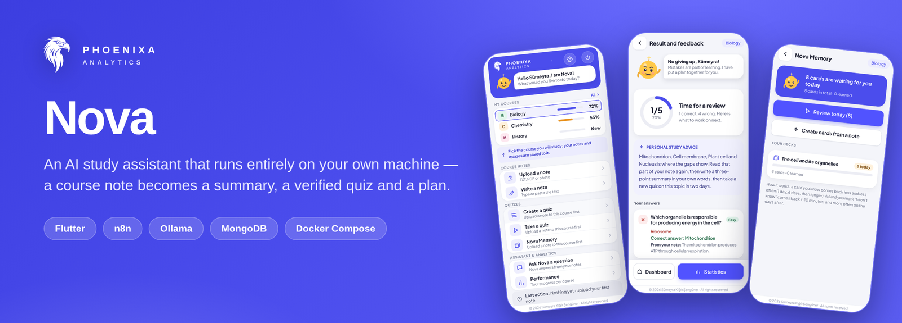
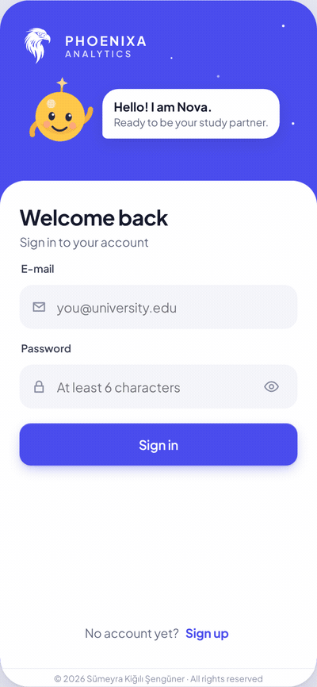
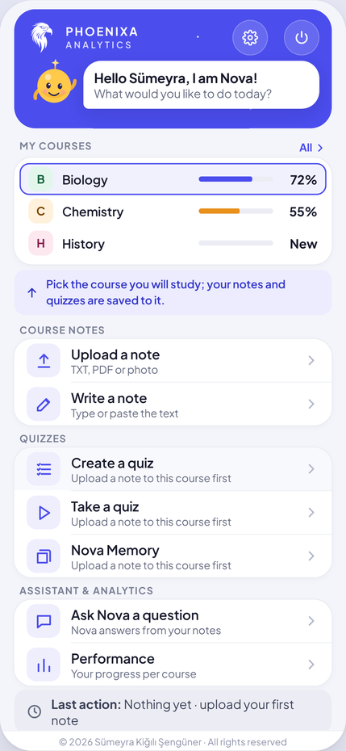
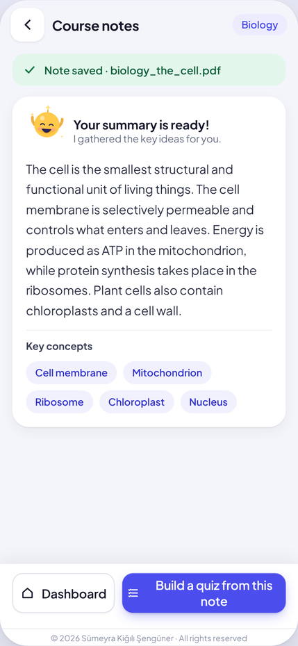
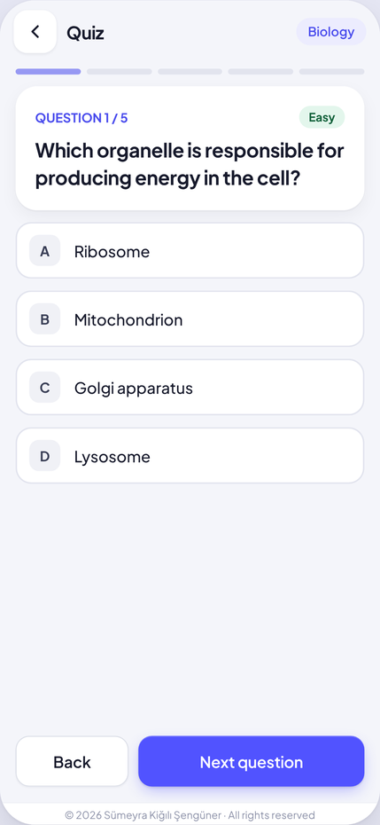
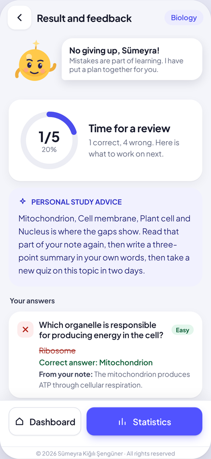
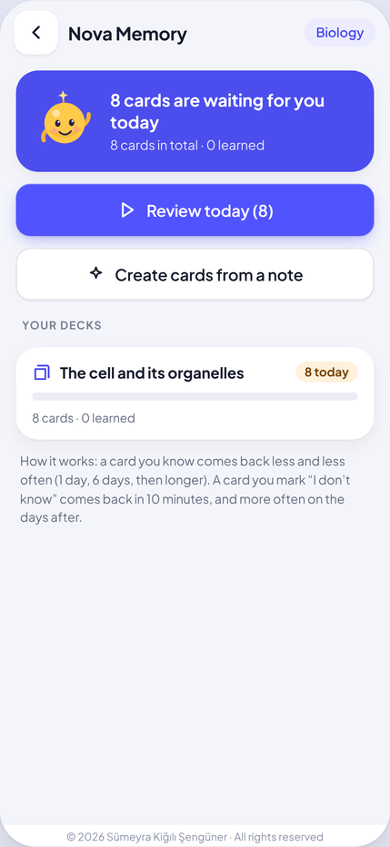
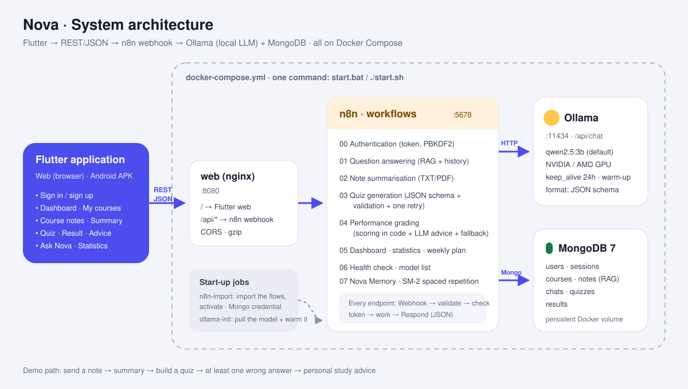
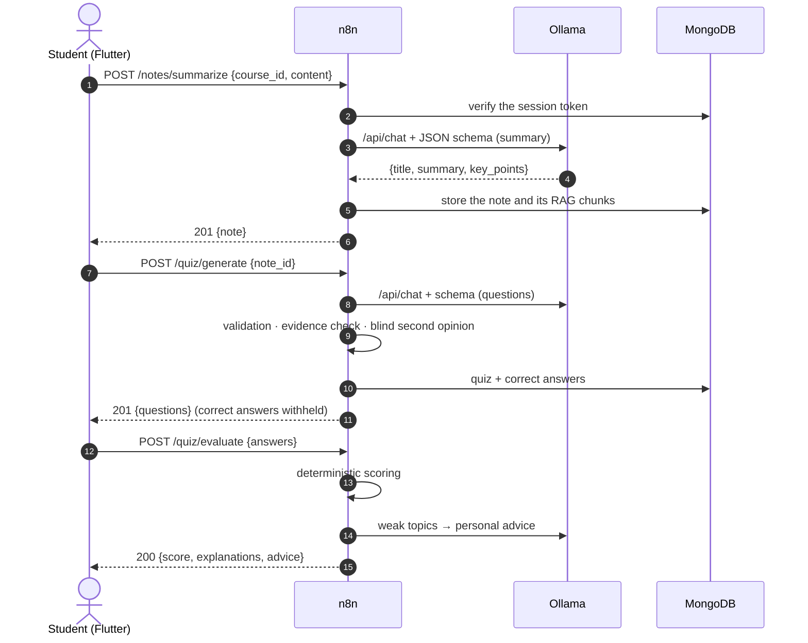

<div align="center">



<br/>


### [▶ Open the live presentation](docs/presentation/index.html) · [Try the prototype](docs/prototype/Nova-Prototype.html) · [Watch the demo](docs/Nova-Demo.mp4) · [Read the decisions](docs/DECISIONS.md)

</div>

---

<table>
<tr>
<td width="38%" valign="top">

</td>
<td valign="top">

### A course note goes in. Studying comes out.

**Upload** a PDF, a text file, or a photograph of a handwritten page.
**Nova summarises it** and pulls out the concepts worth knowing.
**It writes a quiz from that same note** — and checks every question against the note before you ever see it.
**It grades you** and says what to study next, built around the answers you got wrong.

All of it on your own machine. The model runs locally in Ollama, so the notes never leave the device, and there is no per-query bill.

> **The engineering problem worth talking about:** a three-billion-parameter model small enough to run on a laptop will happily write a question whose correct answer is wrong. Five layers stand between the model and the student — a bound JSON schema, semantic validation in code, an evidence sentence verified against the note, a blind second-opinion pass, and one error-feedback retry. [How that works →](#making-a-3b-local-model-reliable)

<kbd>One-click installer</kbd> <kbd>GPU detected automatically</kbd> <kbd>Offline USB package</kbd> <kbd>English · Türkçe</kbd>

</td>
</tr>
</table>

---

## The brief this was built to

Nova began as a take-home case assignment. The brief asked for an AI study assistant with a particular shape; it was delivered in full, then taken further.

| | The brief asked for | What was built |
|---|---|---|
| **App** | A Flutter app with five screens: sign-in, dashboard, chat, course notes, quiz | All five, plus statistics, memory cards and settings |
| **Workflows** | Four n8n flows: question answering, note summarisation, automatic quiz generation (at least 5 questions in a fixed JSON shape), performance grading with advice on weak topics | All four, plus four more: authentication, dashboard and planning, system health, spaced repetition |
| **AI** | A local model served by Ollama | Two models, switchable in the app, plus a vision model that reads photographed notes |
| **Infrastructure** | n8n and Ollama in Docker, one Compose file, a documented model | Eight services, GPU variants, health checks and a one-click installer |
| **Integration** | Flutter against a REST/JSON API with loading, success and error states | 16 endpoints, mapped error codes, a retry path on every AI screen |
| **Data** | Quiz data validated against a schema | Validated twice — once in the workflow, again in the client |

**Added on top of the brief:** answers that cite the sentence they came from (RAG) · quiz questions verified against the note before the student sees them · notes read from a photograph · spaced repetition with SM-2 · a weekly plan built around the student's own study days · a printable weekly report · an English/Turkish interface · an offline installation package · 54 automated end-to-end tests in CI.

Nothing in the brief is missing. Everything below describes both what was asked for and what was built beyond it.

---

## The interface

<p align="center">





</p>

<p align="center"><sub>All nine screens: <a href="docs/img/screens">docs/img/screens</a></sub></p>

| Screen | What it does |
|---|---|
| **Sign in / sign up** | E-mail and password with form validation. A new account is seeded with three courses drawn at random from sixteen. |
| **Dashboard** | Nova's greeting, courses with progress bars, grouped actions, and the last thing the student did. |
| **Course notes** | Upload a TXT or PDF, photograph a handwritten page, or type the note → AI summary and key concepts → build a quiz in one tap. |
| **Quiz** | First the setup: how many easy / medium / hard questions. Questions arrive one at a time; the correct answer stays on the server until the quiz is submitted. |
| **Result** | A score ring, the right answer and an explanation for every question, and personal study advice. |
| **Ask Nova** | Per-course chat answered only from the uploaded notes, with the source shown: note title, file, and the sentence the answer rests on. |
| **Nova Memory** | Cards generated from a note. *I don't know / Hard / Good / Easy* feeds an SM-2 schedule, so forgotten cards return sooner. |
| **Statistics** | Per-course scores, weak topics, a weekly study plan around chosen days and hours, and a printable weekly report. |
| **Settings** | Server address, connection test, Fast / Advanced model choice, vision-model status, and the language switch. |

---

## Architecture



| Service | Job |
|---|---|
| **nginx** | Serves the Flutter web build and maps `/api/*` onto the n8n webhooks, so the app and the API share an origin. |
| **n8n** | Eight workflows, sixteen endpoints — every request walks through validation, authorisation, the model call and the database write as nodes you can watch execute. |
| **Ollama** | The local language model (`qwen2.5:3b` by default, `qwen2.5:7b` optional, `qwen2.5vl:3b` for photographs). |
| **MongoDB** | Users, sessions, courses, notes, chats, quizzes, results and cards — each query filtered by user. |
| **Docker Compose** | Brings all of it up in dependency order, with a health check on every service. |

The launcher script does the rest: it detects the GPU, generates the secrets, builds the web bundle if it is missing, imports and activates the workflows, pulls and warms the model, waits for the health check, and prints the address a phone on the same Wi-Fi can use.

### The demo path



---

## The workflows

| Flow | Endpoints | Worth a look |
|---|---|---|
| **00 · Authentication** | `auth/register`, `auth/login`, `auth/logout` | PBKDF2-SHA256 (100k rounds + per-user salt), constant-time comparison, random course seeding |
| **01 · Question answering** | `chat`, `chat/history` | RAG passage selection, chat history, and the source sentence located in code rather than by a second model call |
| **02 · Note summarisation** | `notes/extract`, `notes/summarize`, `notes/list` | PDF → text, photo → text with a vision model, schema-bound summary, chunking for retrieval |
| **03 · Quiz generation** | `quiz/generate`, `quiz/latest` | JSON schema, validator, evidence check, blind second opinion, one automatic retry, option shuffling, answers withheld |
| **04 · Performance grading** | `quiz/evaluate` | Scoring in code, advice from the model, rule-based fallback advice when the model is unavailable |
| **05 · Dashboard and plan** | `home`, `courses/create`, `plan/weekly`, `report/weekly` | Per-course statistics, weak topics, a plan around chosen days and hours, a printable report |
| **06 · System health** | `health`, `models` | Are n8n, MongoDB, Ollama and the models ready? |
| **07 · Nova Memory** | `cards/generate`, `cards/due`, `cards/review` | Cards checked against the note, today's queue, and the SM-2 computation |

Every protected endpoint follows the same shape:

```
Webhook → validate request → find the session → check authorisation → authorised?
   ├─ yes → business logic → Ollama (separate error output) → validate output → MongoDB → respond
   └─ no  → respond 401 / 400
```

---

## Making a 3B local model reliable

A model small enough to run on a laptop will happily write a quiz question whose correct answer is wrong. Five layers stand between the model and the student:

1. **Bind the shape.** Ollama's structured output (`format`) takes a JSON schema, so the response always parses — no prompt pleading for valid JSON, no regex rescue.
2. **Validate the semantics.** Code checks what a schema cannot: four distinct options, `correct_answer` matching one of them character for character, no duplicate stems.
3. **Demand evidence.** Every question carries a sentence copied verbatim from the note, and code verifies that the sentence really occurs there. A question with invented evidence is dropped before anyone sees it — and that sentence becomes the explanation on the result screen.
4. **Ask again, blind.** The model answers its own questions without seeing the correct answers. Where the two passes disagree, the question is dropped.
5. **Retry with the errors.** If validation fails, the model's own output and the list of errors go back with an instruction to fix them. One retry, then the request fails honestly rather than returning something broken.

Two spare questions are generated per quiz so the drop-outs never leave the student short. Asking for a second quiz from the same note sends the previous questions along as a "do not repeat" list.

**Prompt design, in short:** role, numbered rules, and a declared output shape; an explicit refusal to invent ("use only what the text says"); a `topic` tag on every question so mistakes aggregate by topic and feed both the statistics and the weekly plan; and personalisation with evidence — the grading prompt carries the student's name, score, and for every wrong question their answer, the right answer, the topic and the explanation.

---

## The API

Sixteen endpoints under `/api/nova/`, each answering `{ok: true, …}` or `{ok: false, error: {code, message}}` with the matching HTTP status. Protected endpoints expect `Authorization: Bearer <token>`.

`auth/register` · `auth/login` · `auth/logout` · `home` · `courses/create` · `notes/extract` · `notes/summarize` · `notes/list` · `quiz/generate` · `quiz/latest` · `quiz/evaluate` · `chat` · `chat/history` · `plan/weekly` · `report/weekly` · `cards/generate` · `cards/due` · `cards/review` · `health` · `models`

A generated quiz, as the model returns it and MongoDB stores it:

```json
{
  "questions": [
    {
      "question": "Which organelle is responsible for producing energy in the cell?",
      "options": ["Ribosome", "Mitochondrion", "Golgi apparatus", "Lysosome"],
      "correct_answer": "Mitochondrion",
      "explanation": "The mitochondrion produces ATP through cellular respiration.",
      "topic": "Mitochondrion"
    }
  ]
}
```

The response the student receives carries neither `correct_answer` nor `explanation`; both appear only in the result of `quiz/evaluate`.

| Code | HTTP | Meaning |
|---|---|---|
| `VALIDATION` | 400 | A field is missing or invalid |
| `UNAUTHORIZED`, `SESSION_EXPIRED`, `INVALID_CREDENTIALS` | 401 | No session, expired, or wrong credentials |
| `NOTE_NOT_FOUND`, `QUIZ_NOT_FOUND` | 404 | Not found **or owned by someone else** |
| `EMPTY_TEXT`, `PDF_ERROR` | 422 | No text could be extracted from the file |
| `AI_UNAVAILABLE`, `AI_INVALID`, `QUIZ_INVALID` | 502 | The model failed or returned something unusable |
| `MODEL_MISSING` / `AI_TIMEOUT` | 503 / 504 | The model is still downloading / took too long |

---

## Security, performance, tests

**Security.** Course notes never leave the machine. Passwords are stored as PBKDF2-SHA256 with 100,000 rounds and a per-user salt. Sessions are 32-byte random tokens, deleted server-side on sign-out. Reaching for someone else's quiz, note or chat returns `404`, so not even its existence leaks. Ollama binds to localhost only and MongoDB is not published at all. Secrets are generated at install time and never committed.

**Performance.** The model is warmed at startup and kept in memory, and every call uses the same context length so Ollama never reloads it. RAG sends only the four most relevant passages rather than the whole note. The vision model loads only when a photo is uploaded and is released afterwards. Source lookup, card scheduling, the weekly report and the SM-2 computation all happen in code, with no extra model call.

**Tests.** 54 end-to-end checks replay the whole path from sign-up to the weekly report, failure cases included: a model that returns a broken quiz, Ollama switched off, a corrupt PDF, and an attempt to read another user's data. A mock-Ollama harness lets CI run without a GPU; GitHub Actions also runs `flutter analyze`, the unit tests, and the web and Android builds.

---

## The source code

This repository is the showcase: the write-up, the engineering decisions, the presentation, the prototype and the demo.

**The source — the Flutter app, the eight n8n workflows, the Docker setup and the test suite — lives in a private repository and is shared on request** with people evaluating this work. Get in touch through the GitHub profile linked above and access follows.

---

## Licence

© 2026 Sümeyra Kiğılı Şengüner. All rights reserved.

This work is published so that reviewers, recruiters and hiring teams can examine it. Reading and evaluating it is welcome; copying, reproducing, distributing or presenting it — in whole or in part — as one's own project, assignment or product is not. See [LICENSE](LICENSE).

<div align="center">
<br/>

</div>
